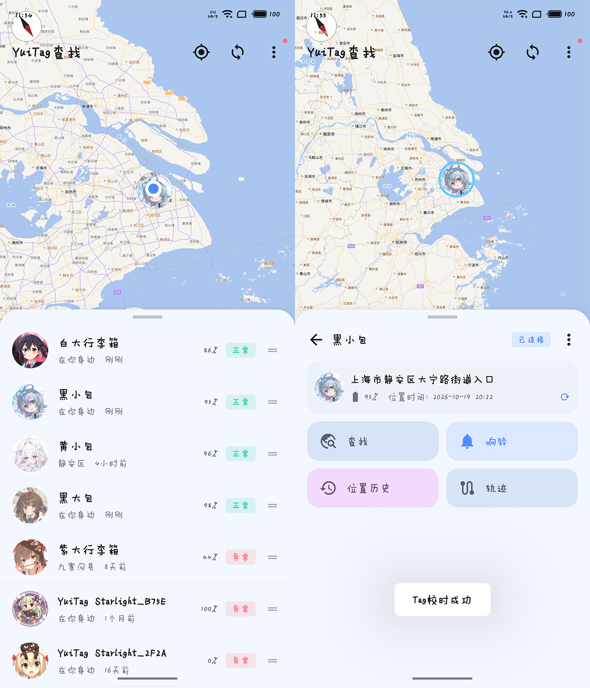
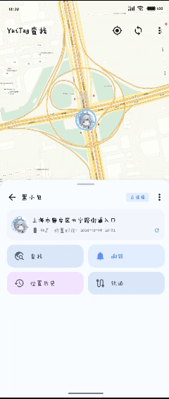
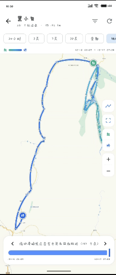
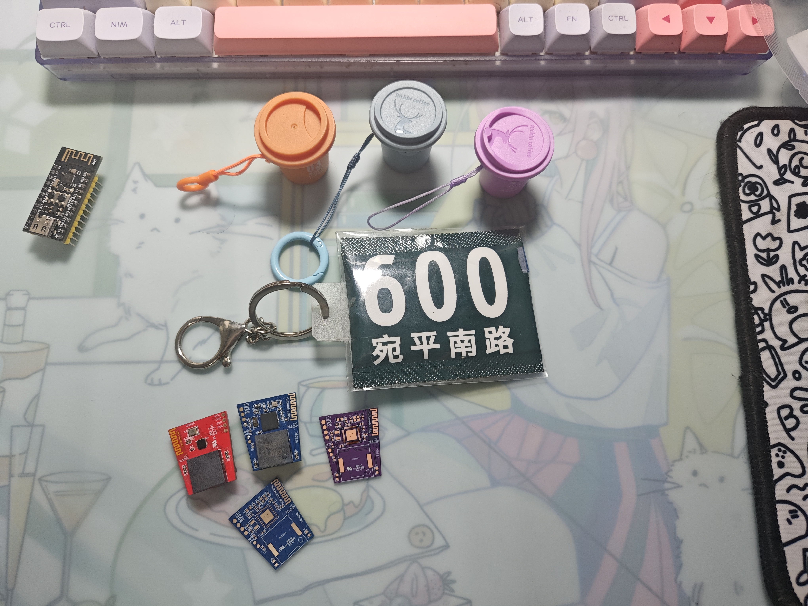

# YuiTag

  

## 简介 

**YuiTag**是一个可以帮你在忘记东西放哪时寻找物品的蓝牙寻物Tag。  
通过**YuiTag App**在连接设备后可以发送响铃指令通过蜂鸣器声音寻找Tag。  
同时还兼容 **FindMy** 网络，并实现了基于时间的无限密钥派生，能够在室内寻物的基础上提供一定的全球定位能力。  
配套**YuiTag App**支持个性化配置，包括查找页面主题，Tag图标，蓝牙广播间隔，FindMy密钥轮换时间等配置。  
针对有限固定密钥组的类型还利用App支持了随时写入全新的一组密钥而无需重新烧录固件。  
  
YuiTag有两个版本 Sparks火花 / Starlight星光   
Sparks支持**有限**轮换密钥组的FindMy网络  
Starlight支持**无限**动态密钥的FindMy网络  

## 兼容性

## 演示图
  

**GIF图，加载可能需要一段时间，可能需要手动触发播放**

  
  

  

## 运行

1. 焊接PCB硬件
2. 烧录固件
3. 配置YuiTag App
4. 使用YuiTag App绑定Tag
5. 配置Tag
6. Enjoy, heart❤️! =w=

以上为简要步骤，具体请查看：  
关于硬件，请查看 [硬件文档](/tools/Documentation/Hardware.md)  
关于固件，请查看 [固件文档](/tools/Documentation/Firmware.md)  
关于YuiTag App，请查看 [App文档](/tools/Documentation/App.md)  

## 下载

- 预编译固件和App及PCB制板文件，  
前往 [Github 发布页](https://github.com/Reiyy/YuiTag/releases)  

## 注意事项/其他

> [!CAUTION]
> **请勿依赖本Tag为你寻找重要物品！** **请勿将其作为获知任何重要物品位置的唯一途径！** 如有贵重物品防丢需求，请选购成熟商业产品（如 Apple AirTag、小米 Tag、华为 Tag、三星 Tag等）。  
> **AI警告**：本项目代码主要由AI编写，虽所有决策和方案设计由人类完成且经过复核，但对于可靠性、长期运行稳定性及潜在边界异常仍不能保证。

> [!NOTE]
> 本项目主要用于**室内寻物**。FindMy为辅助功能，其实时性与准确性受限于周围 Apple 设备密度；同时 DIY 硬件缺乏专业射频调校，天线性能无法与成熟商业产品相比，存在信号覆盖距离可能较短的限制。

* **无限派生密钥**：Tag 与 App 预先共享同一个 FindMy 种子。App 连接 Tag 时同步当前时间戳并与其锚定，之后双方可各自基于相同的时间计算出一致的广播密钥。
* **低配芯片兼容（如 nRF52810）**：针对 Flash/RAM 不足、无法自主计算动态派生的芯片，得益于 App 的可连接设计，当发现定位刷新变少时，可直接通过 App 下发写入一组全新的预生成密钥组，无需重新烧录固件。
* **乐观恢复**：日常换电池等断电场景通常只有几分钟，Tag 每 5 分钟自动将当前时间覆写回 Flash 时间戳。重新上电后时间最大偏差通常不会超过 10 分钟。
* **补偿策略**：
  * **查询范围扩展**：App 端提供了可配置的查询扩展参数，可补偿断电偏差与晶振走时漂移。
  * **自动校时**：每次进入 App 的 Tag 详情页时会自动连接设备并同步时间。

## 路线图

- [x] 基于蓝牙信号的近场大致定位  
- [x] 基于蜂鸣器响铃的近场精确声音定位 
- [x] 兼容FindMy网络并支持无限密钥派生
- [x] 可个性化配置的查找App  
- [x] 支持OTA固件更新（仅Starlight）
- [x] 遗落提醒(实验性)与魅族Flyme实况通知
- [x] App集成FindMy数据查询(脱离自建后端依赖)
- [ ] 适配沁恒 CH59x 芯片
- [ ] 设计更大容量电池的硬件
- [ ] 支持自定义蜂鸣器响铃旋律
- [ ] 更完善的遗落提醒
- [ ] iOS端App移植

## 参与的模型

## 致谢

- [lovelyelfpop/macless-haystack](https://gitee.com/lovelyelfpop/macless-haystack): 提供macless-haystack后端，和FindMy实现参考
- [acalatrava/openhaystack-firmware](https://github.com/acalatrava/openhaystack-firmware): 提供FindMy数据格式和固件编写参考
- [lightStarrr/starSchedule](https://github.com/lightStarrr/starSchedule): 提供魅族Flyme实况通知的实现参考
- [tieo/TagHistory](https://github.com/tieo/TagHistory): 提供本机直连位置查询与协议交互参考，以及JNI运行库
- [sacca97/os-findmy-e](https://github.com/sacca97/os-findmy-e): 提供CoreADI提取方案与ADI模拟实现参考

## 许可证

YuiTag 采用 **多许可证(Multi-License)** 发布。不同组件分别适用以下开源许可证：

App及固件 (./App、./Firmware)：  
采用 **[GNU General Public License v3 (GPL-3)](https://www.gnu.org/licenses/gpl-3.0.html)** 许可证.

硬件 (./Hardware)：  
采用 **[CERN Open Hardware Licence Strongly Reciprocal v2 (CERN-OHL-S v2)](https://ohwr.org/cern_ohl_s_v2.txt)** 许可证.

---

  
K - ON!

  

